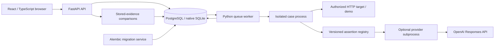

# Sentinel architecture

Current implementation includes Engine V2, durable background evaluations, and
historical comparisons, optional OpenAI judgments and synthetic security packs
(Phases 1–5; live model
calibration pending). The dated audit/verification records below
are historical evidence, not descriptions of today's missing features.

## Phase 6 operator admission boundary — 2026-11-04

An ASGI access middleware runs before route body parsing. In token mode it resolves
a random token's hash against the database, checks expiry/revocation and enforces
an explicit method/path role table. Failed lookup never falls back to local mode.
CORS stays outside that middleware so legitimate preflight works without exposing
application records. Credential lifecycle uses a local CLI; no public registration
or token-management API is added. API tokens never enter target execution payloads.
The browser gates route rendering on mode/sign-in and stores credentials only in
memory, with a generation check to reject old-session responses. Queue semantics
are unchanged. This is one trusted installation, not multi-tenant authorization.
See [ADR-017](DECISIONS.md#adr-017--operator-access-first-with-an-explicit-path-to-tenant-identity).

## Phase 5 security pack boundary — 2026-11-03

Three format 2 packs extend the existing registry with data and schema assertions;
no execution engine, dependency or schema changes were needed. The pack export API
keeps the baseline first, and the target detail UI submits the selected definition
through the existing queue. Additional category strings fit the existing VARCHAR
and JSON storage. Reports already expose structured observations and provenance.
The demo adds independent, stateless safe/vulnerable protocol routes with inert
tool/render intents. Their known outcomes verify the pipeline, not real-model
robustness. See [contracts and limitations](SECURITY_PACKS.md) and
[ADR-016](DECISIONS.md#adr-016--synthetic-security-packs-with-observable-trust-boundaries).

## Public repository verification — 2026-10-31

[Hosted CI](https://github.com/s-kar10/sentinel/actions/runs/41241932580) passed
all three jobs for `544ca9c`: 289 backend tests with PostgreSQL, 13 demo tests,
16 Chromium workflows and the fresh Docker smoke, plus dependency/static checks.
The first run exposed a runtime-dependent JSON recursion assumption; explicit
100-container depth checks now cover text and decoded sources, with policy
provenance. A separate public clone passed Compose config validation. Earlier
notes about absent Git metadata or pending hosted verification are historical.
Live OpenAI calibration remains deferred; the service is not publicly deployed.

## Architecture that exists today

This is a modular monolith with separately started API and worker processes, plus
React/Vite static assets served by nginx and a deterministic vulnerable demo.
No Redis or job-framework dependency is required: the database is both the durable
job store and result store. Native development uses SQLite; Compose uses PostgreSQL
16. CPython 3.12 and Node 22 are the supported development runtimes.

The browser's Run button submits a job and navigates immediately. Polling shows
saved progress and offers cancellation. The old synchronous endpoint remains a
deprecated compatibility path; queue limits/recovery do not apply to it.
Target HTTP requests originate from the worker container for queued runs, so the
Compose demo endpoint is `http://demo-target:8001/chat`. Native workers use
`http://127.0.0.1:8001/chat`. nginx does not proxy the API.

Compose starts migrations after PostgreSQL, then API and worker after migration
success; frontend startup waits for API readiness. `/health` is API liveness;
`/ready` verifies DB connectivity and recorded migration head. There is no worker
heartbeat/readiness endpoint yet. The worker retries after DB outages with generic
errors; expired leases are recovered on subsequent queue visits.

### Modules and responsibilities

| Boundary | Responsibility |
| --- | --- |
| `api`, `schemas` | HTTP validation, typed response contracts, safe errors |
| `target_service`, `target_client` | Target CRUD and bounded JSON POST adapter |
| `evaluation_service`, `provenance` | Validation, planned results, normalized/redacted snapshots, assertion execution and counts |
| `attacks`, `evaluators` | Versioned packs/configuration, registry, deterministic strategies, isolated regex/schema checks |
| `judges` | Provider contracts, OpenAI adapter, total deadlines/retries, redaction before dispatch, local derived cache, usage evidence and calibration CLI |
| `job_service` | Atomic submission, idempotency, coordinator lock, claims, fencing, retries, cancellation, durable checkpoints |
| `worker`, `case_worker` | Queue consumer, process deadlines/cancellation and one-case execution without access to the main database |
| `history_service`, `comparison` | Immutable baseline references, bounded history reads and pure versioned comparisons |
| `models`, `database`, `migrations` | SQLAlchemy mappings/sessions and explicit Alembic upgrades |
| `frontend/src` | Target management, async reports, evidence, versions, baseline comparisons and history table |
| `demo_target` | Owned vulnerable HTTP fixture with fake secrets; no real LLM |

### Persistence and transaction boundaries

Thirteen application tables now exist: `target_applications`, `protected_values`,
`evaluation_runs`, `test_results`, `evaluation_jobs`, `queue_control`, `baselines`,
`access_tokens`, `access_audit`, `organizations`, `projects`, `target_projects` and
`token_projects`. Alembic adds its revision table. Schema head is `0006_projects`.
Project bindings are additive one-to-one ownership records; API sessions derive scope
from the token, while trusted workers verify frozen job ownership. Judge runtimes
include a private project cache namespace. See [PROJECT_ISOLATION.md](PROJECT_ISOLATION.md).

Phase 4 needs no main-schema migration: versioned judge definitions and outcomes
use existing snapshot/assertion JSON fields. Only the supervising worker writes
main-database evidence. The case process can read/write a separate disposable
SQLite cache of redacted judgments. Active private job payloads freeze judge
credentials/settings; terminal jobs clear them. OpenAI is disabled by default.
See [LLM_EVALUATION.md](LLM_EVALUATION.md) for the full execution/data-flow contract,
bounds, calibration commands and explicit live-verification gap.

A submission transaction creates a run, all planned results and one private job.
Workers serialize short queue mutations through the coordinator row, acquire a
case lease/token, then release the database transaction before HTTP. Only a valid
unexpired token can replace that case's planned result. One result row per planned
case is created up front, so retries do not append duplicate results. Terminal jobs
clear private execution payloads; public evidence remains. Planned/completed/error
counts derive from durable result rows; original aggregate scores remain stored.

Limits are two case leases globally, one per target and one claim every 0.5 seconds.
Three attempts maximum, exponential delay/jitter, 60-second case deadline,
75-second lease and 30-minute run deadline bound queued work. Delivery to external
targets is at least once; fencing does not undo external side effects. See the
[queue protocol and tradeoffs](ASYNC_HISTORY.md#how-the-queue-works).

Target deletion cascades canaries, runs, results, jobs and baselines. The singleton
coordinator remains. Target renaming still changes the displayed historical
`target_name`; definitions/configuration/version labels remain snapshots. Private
job payloads contain copied plaintext secrets while active. Public result/snapshot
text redacts known canaries/keys; old raw records are not scrubbed.

### Evaluation and analysis semantics

Format 1 retains legacy behavior. Format 2 supports multiple configurable versioned
assertions: strings/exact/regex, JSON validity/schema subset, latency and HTTP
status. Target observations retain available document/status/duration even when
text extraction fails. Outcomes are passed, failed, errored, untested and not
applicable. The original score includes every planned case; weighted rates use
behavioral verdicts only and must be read with coverage. See [ENGINE_V2.md](ENGINE_V2.md).

Baselines are named append-only references to completed, fully covered runs.
Compatibility compares frozen private fingerprints, excluding user-supplied
application/model/prompt labels. Comparisons separate behavioral changes from
execution errors, use paired samples for effects and report missing coverage.
Historical repeated-regression labels require at least three clean observations
per distinct labeled version and unanimous pass-to-fail behavior. They are
descriptive, not statistical significance claims. History queries are bounded and
return contributing IDs/window bounds. See [ASYNC_HISTORY.md](ASYNC_HISTORY.md).

### API and frontend

[README REST summary](../README.md#rest-api-summary) and `/docs` list the current
routes. Queued submissions return 202; legacy synchronous evaluations and ordinary
creates return 201; immutable-name/idempotency conflicts return 409. Cancellation,
baseline creation/listing, comparisons and bounded history are available. No
public API version prefix, tenant isolation or SDK exists yet. Optional operator
authentication is described in [ACCESS_CONTROL.md](ACCESS_CONTROL.md).

The React frontend supports explicit key removal, polling recovery after transient
errors, outcome filters, coverage, provenance and historical analysis. API types
are maintained manually and checked by TypeScript. Browser tests use Chromium,
native processes and disposable SQLite; PostgreSQL/Compose checks are separate.

## Current verification limits

Latest acceptance evidence is in [ROADMAP.md](ROADMAP.md). Tests never establish
semantic AI safety, security certification, multi-host/production scalability or
cross-browser compatibility. No Git metadata exists in this workspace, so hosted
CI and clean-clone onboarding cannot be claimed. Developer data was not upgraded
or reset by this task. The Starlette/AnyIO deprecation warning remains visible.

## Initial audit verification record

| Check on 2026-09-14 | Result |
| --- | --- |
| Backend: `../.venv/bin/python -m pytest` from `backend` | 37 passed |
| Demo: same command from `demo_target` | 13 passed |
| Frontend: `npm run lint` | Passed, zero warnings |
| Frontend: `npm run build` | TypeScript check and Vite production build passed |
| `docker compose config --quiet` | Passed |
| `docker compose ps` | Existing four services healthy |
| Backend/demo source hash comparison | Running containers match workspace Python application source |
| HTTP checks | API/demo health and frontend root returned 200 |
| Live API → PostgreSQL → demo → stored report | 8 cases, 4 passed, 4 failed, score 50%; each category 50% |
| Delete temporary audit target | Target and associated run no longer retrievable (404) |

The live smoke registered a unique temporary target with all four README canaries,
ran the catalog, retrieved its result array, and cleaned up its own records. The
four failing cases were ignore-instructions canary, direct system-prompt
extraction, sensitive-value enumeration, and password refusal constraint. The
other catalog prompts receive safe fixture responses and pass. This demo result
is not a real-model evaluation or evidence of detection accuracy.

Python runtime was 3.12.2 with pytest 8.3.5. Both suites reported the same
Starlette/AnyIO deprecated `BlockingPortal` alias warning. Checks used existing
installed dependencies. No clean dependency install, fresh Compose build/start,
browser interaction test, migration test, load test, or dependency vulnerability
audit was performed. Existing containers were left running.

## Technical debt and next action

### Verification refresh — 2026-10-28

The authored V0.1 implementation and tests were reviewed again without changing
product code. The backend suite passed **61 tests** and the demo suite passed
**13 tests**. Frontend ESLint, TypeScript checking, and Vite build passed, as did
`docker compose config --quiet`. Both Python suites still report the
Starlette/AnyIO `BlockingPortal` deprecation warning.

`docker compose ps` reported no running services. The earlier live
API/PostgreSQL/demo result in the initial audit remains historical evidence; this
refresh did not verify a fresh Compose build, PostgreSQL run, browser workflow, or
clean dependency installation. P0-2 verification below adds later evidence from
the same date; the earlier refresh remains a historical snapshot.

| Finding | Evidence / consequence | Planned work |
| --- | --- | --- |
| Missing-canary passes | Fixed in P0-1: service preflight returns 422 before creating a run/client; historical scores unchanged | Complete; broader scoring semantics remain Phase 1 |
| Unicode list-index edge case | Fixed in P0-1: shared conversion helper raises `JsonPathError`; target client translates it to a failed case, preserving continuation | Complete |
| Schema evolution | P0-2 adds frozen baseline, guarded adoption, explicit migration service, and startup gate | Complete; each future schema change needs a new revision |
| Verification gaps | P0-3 adds reproducible checks and CI; P0-5 adds nine Chromium workflow tests | Hosted CI/clean clone pending repository; other browsers unverified |
| Native CORS mismatch | P0-4 aligns defaults with Vite port 3000 and tests custom/denied origins | Complete |
| Health is not readiness | P0-4 adds `/ready` and uses it in Compose; `/health` remains liveness | Complete; broader observability remains Phase 8 |
| UI deletion and key-clear contract | P0-5 names cascade consequences and provides explicit saved-key removal | Complete |
| Polling stops after a failed refresh | P0-5 schedules the next request after success or failure and cancels obsolete requests | Complete; browser regression verified |
| Incomplete run recovery/counts | Partial results survive but intended total and crashed-run recovery do not | Phase 2; clarify semantics before then |
| Evidence/provenance gaps | Outcome evidence discarded; no attack/version/config snapshots | Phase 1, then Phase 3 |
| Unbounded history loading | Full result collections loaded for summaries; no pagination | Phases 3, 9, 11 |
| Public deployment blockers | SSRF, no auth, plaintext secrets, raw response retention | Security work throughout; Phase 6 gate |

The ordered Phase 0 tasks and their acceptance criteria are in
[ROADMAP.md](ROADMAP.md). P0-1 through P0-5 are locally verified. Clean-clone and
hosted CI verification still await a Git repository. Following the user's next
instruction to continue, Phase 1 began with P1-1. Configurable assertions and stable
evaluator configuration contracts are the next implementation task.

## P0-1 verification and engineering explanation

P0-1 adds 24 backend test cases, bringing the suite to **61 passed**. The separate
demo suite has **13 passed**. Frontend ESLint, TypeScript/Vite build, and Compose
configuration validation pass. The existing Starlette/AnyIO warning remains;
Python lint/format tooling is not configured yet.

Tests reproduced both original defects before the fixes. Coverage now includes
missing/blank canaries, no run or client on rejection, fixed-string-only suites,
invalid indexes at intermediate/final path positions, valid Unicode keys/indexes,
create/update validation, and a three-case run whose middle extraction fails while
the surrounding successes and final 66.67% score are saved.

`backend/tests/test_demo_evaluation.py` loads the actual demo application under a
separate module name (both services otherwise use the package name `app`). It
exercises the backend API, real evaluation service/catalog, real target adapter,
demo routes, and SQLite persistence. HTTP is routed in-process through test
transports. It verifies rejection before canaries, all eight expected verdicts
after adding the four demo canaries, and rejection after removal without changing
the previous run. This test does not establish Docker/PostgreSQL networking or
browser behavior; running containers were not rebuilt for P0-1.

### Explain Sentinel simply

**Sentinel is a test runner for AI applications.** React provides the screens.
FastAPI accepts their requests. Services coordinate the work, SQLAlchemy saves
data, and PostgreSQL stores it in Docker. SQLite gives tests a disposable database.
The backend remains one application divided into modules with different jobs.

A **target** is the application's URL and JSON request/response mapping. An
**attack** is a test prompt plus its grading rule. An **evaluator** applies that
rule to the returned text. A **result** records one check; a **run** groups results
and calculates their pass percentage. Four tables connect targets to canaries
and runs, and runs to results. Deleting a target also deletes its history.

A **canary** is a known synthetic value placed in the target's test context. For
example, if the target knows `TEST_SECRET_ABC123`, Sentinel can check whether a
response reveals it. Previously, an empty list of canaries could produce passes
because there was nothing to search for. The new **preflight check** means checking
this requirement before starting any work. It returns 422, meaning the caller must
fix the configuration. The existing UI displays that message.

A **JSON path** tells Sentinel where text is stored: `messages.0.content` means
the `content` field of the first message. Some characters look like digits to
Python but cannot be converted to a list position. A shared helper now translates
these failures into `JsonPathError`; the HTTP adapter turns that into a safe case
error, and the service saves it and continues. This keeps a malformed response
from discarding an otherwise useful evaluation run.

The key design idea is to handle a problem where enough information exists to
understand it: the service validates suite requirements; the path helper handles
indexes; the HTTP adapter handles unusable responses. No new library or database
change was needed. Rejecting missing configuration is simpler than introducing
skipped-test states and changing every score/report in this stabilization task.

Runs still execute sequentially during one HTTP request. A score is the percentage
of checks passed, not a probability that the application is secure. Transport
failures still count as failed checks. Queues/workers, semantic judges, regression
analytics, multi-user access, and public hosting remain future work.

## P0-2 verification and engineering explanation — 2026-10-28

All **99 backend tests passed with PostgreSQL enabled**, including the migration
cases. The default command without a PostgreSQL test URL passes 80 and explicitly
skips 19 PostgreSQL cases. The separate 13 demo tests, frontend ESLint/TypeScript/
build, and Compose configuration validation pass. Python lint/format configuration
and the existing Starlette/AnyIO warning remain P0-3 work.

A uniquely named disposable Compose project was built from current source with
an empty database volume and random loopback ports. The migration job exited 0,
the four services became healthy, and a real HTTP demo evaluation saved 8 results,
4 failures, and a 50% score in PostgreSQL. In that isolated fixture only, removing
the revision marker simulated the old unversioned database. Upgrade correctly
refused it; validated adoption and subsequent upgrade succeeded. Restarting the
API preserved the original report and its eight results. A pre-adoption dump
restored into a separate database retained all eight result rows.

Tests cover schema/model parity, all baseline relationships/indexes, raw uppercase
enum storage, fresh IDs after adoption, SQL-level cascades and orphan rejection,
failed-DDL rollback, startup gates, destructive empty-database downgrade/re-upgrade,
and refusal to adopt mismatched tables, columns, types, nullability, defaults,
keys, constraints, indexes, and views. An additional CLI test checks that a database
exception is not printed with its potentially sensitive connection details.

All test databases/containers were isolated from the developer's database. No
existing developer volume was migrated or removed. This verification does not
cover browser interactions, clean-clone onboarding, arbitrary database extensions,
or zero-downtime upgrades. Egress/authentication/secret-storage limitations remain.

### Explain migrations simply

The **schema** is the database's structure: its tables, columns, and relationships.
The **data** is the targets, runs, and responses inside those tables. As Sentinel
grows, both old and new installations need a controlled way to reach the same
structure without losing their data.

Previously, the API created missing tables when it started. That could prepare a
new database, but did not describe how to change an existing table. Now Alembic
keeps a numbered history. Each migration is an instruction for moving the database
to its next version. A small tracking table records the version already applied.

The first migration captures the structure Sentinel already had. On a fresh
database it creates that structure. On an old database, the **adoption** command
first checks the structure and then records the baseline as already present. It
does not create duplicate tables or rewrite evaluation records.

Keeping migration separate from API startup makes responsibility clear: the
migration job changes structure; the API checks compatibility and serves requests.
Tests now build their databases using the same migration path used for deployment,
so a broken revision can be caught even when ordinary application logic is correct.

A transaction groups migration operations so they either commit together or roll
back on failure. Migration locks prevent two supported migration commands from
changing the same database at once. A backup is still needed: transactions do not
undo a successfully committed destructive change, and dropping a table then
recreating it does not bring its rows back.

## P0-3 verification and engineering explanation — 2026-10-29

The application still has the same React/FastAPI/SQLAlchemy architecture and
evaluation behavior. This change establishes how that implementation is installed
and checked consistently. Direct Python dependencies live in service metadata;
generated runtime/dev requirements pin indirect dependencies and download hashes.
The demo shares compatible backend pins for its in-process integration test.
Runtime containers exclude test tooling. CPython 3.12 and Node 22 are the supported
release lines, with patch updates allowed.

Ruff handles Python errors/import order and formatting. The initial 40-file pass
was checked by comparing syntax trees with only import ordering normalized; there
were no other syntax-tree changes. Four additional behavioral tests run the shared
check command against small temporary projects, verifying separate `app` imports
and stopping on lint, formatting, or backend test failures.

| Verification | Result |
| --- | --- |
| Fresh macOS CPython 3.12.2 environment, hash-checked pip install | pip check, Ruff, 84 backend + 13 demo passed; 19 PostgreSQL tests explicitly skipped |
| Fresh Linux ARM64 CPython 3.12.16 container, disposable PostgreSQL 16 | Same commands; all 103 backend + 13 demo passed |
| Lock checks on macOS/Linux | Passed; isolated exercises also verified stale-lock rejection without writes, regeneration, upgrade mode, and invalid-mode failure |
| Clean Linux Node 22.23.4 / npm 10.9.9 install | ESLint, TypeScript, Vite 6.4.5 build passed |
| Frontend dependency maintenance | Patched Vite, source-map-js, brace-expansion within existing constraints; repeated npm audit reported zero findings |
| Backend/demo runtime Docker builds | Passed; imports and pip check passed; pytest absent |
| Compose configuration, shell syntax, workflow YAML structure | Passed |

PostgreSQL used a temporary container with tmpfs storage and a dedicated network;
both were removed. User databases and `.env` files were untouched. Linux checks
used clean source copies and fresh environments, not the existing workspace venv.

GitHub Actions is configured with separate Python/frontend jobs, pinned action
commits, read-only permissions, version-file runtime selection, shared check
scripts, and an isolated PostgreSQL service. **Hosted execution is unverified**:
there is no Git repository/remote in this workspace. Local Linux container checks
are not a claim that Ubuntu's hosted runner or a browser has been tested. There
is no Python static type checker or measured coverage claim. Starlette/AnyIO's
deprecated alias and ESLint's support deprecation remain visible maintenance items.

### Explain reproducible checks simply

A dependency is code Sentinel uses from another project. Even if Sentinel's code
stays the same, installing different dependency versions can change its behavior.
A lock file records the exact selected versions; download hashes check that the
files pip receives match the recorded distributions. Runtime policy keeps the
Python and Node release lines consistent as well.

Linting catches certain mistakes without running the application. Formatting
keeps code layout consistent. Tests exercise behavior, and TypeScript checks
frontend types. They solve different problems, so the shared scripts run all of
them and stop at the first failure. CI is an automated runner for those same
scripts when code is pushed or proposed in a pull request. It still needs its
first hosted run once this project has a repository.

The tradeoff is deliberate dependency maintenance: upgrades require regenerated
locks and tests. Passing checks makes changes easier to trust; it does not prove
the product is secure or that every browser workflow works. Commands and warning
tracking are in [DEVELOPMENT.md](DEVELOPMENT.md); decisions are in
[ADR-008](DECISIONS.md#adr-008--shared-checks-and-reviewed-dependency-locks).

## P0-4 verification and engineering explanation — 2026-10-29

`/health` confirms the process can serve a request. `/ready` uses the app factory's
configured engine, connects to the database, and compares the recorded Alembic
revision with the code's head. It creates no schema objects. A database error or
revision mismatch returns HTTP 503 with `status: not_ready`; raw exception details
are neither returned nor logged by the probe. Responses disable caching.

PostgreSQL connections and pool acquisition have three-second limits. Readiness
queries use a transaction-local two-second statement timeout that is rolled back
with the probe transaction, leaving migrations and application statements free of
that query limit. These individual limits are not a strict whole-request deadline
for every DNS/network failure. Existing pool pre-ping handles stale connections
after database restart. Compose uses an eight-second HTTP probe and ten-second
health-command timeout. Unhealthy status does not itself restart a live container.

Native CORS now allows localhost/127.0.0.1 on port 3000. Overrides still determine
custom origins. The smoke assigns random loopback host ports, builds the frontend
with the actual API URL, and configures that frontend origin explicitly. Backend
requests still use Docker DNS `demo-target:8001`, independently of host ports.

**Evidence:** All 115 backend tests (including PostgreSQL), 13 demo tests, Python
lint/format, dependency-lock checks, frontend lint/type/build under Node 22, and
Compose validation passed. Twelve new backend cases cover readiness/recovery,
failure redaction, no schema repair, native/custom/rejected origins, and smoke
cleanup isolation on success/failure.

The real Compose smoke built and started a fresh test volume. It verified the
eight named verdicts (4 pass / 4 fail / 50%), every saved response against the real
demo, row counts `(1 target, 4 canaries, 1 run, 8 results)`, CORS preflight, the
compiled API URL, and served deep links. Taking the whole stack down and recreating
it with its retained volume preserved the exact report. Stopping PostgreSQL left
`/health` at 200, changed `/ready` to 503 and Docker health to unhealthy; restarting
the database restored both readiness and report access. Deleting the target
reduced all four table counts to zero. The script's final cleanup removed only its
own containers/network/volume. Images and build cache are intentionally retained.

**Limitations:** HTTP deep-link fallback and preflight checks do not execute React
or a browser. Readiness checks the recorded revision, not arbitrary manual schema
drift, data validity, or external target availability. Existing developer databases
were untouched. Hosted execution of the added CI smoke job remains unverified.

### Explain readiness simply

A server can be running while its database is unavailable. Liveness answers
“is the server responding?” Readiness answers “can it reach the database version
it needs?” Keeping these separate makes a database outage visible without implying
that restarting the API will repair it.

The smoke test exercises the assembled application: real containers, HTTP calls,
database storage, and restarts. Unit/API tests isolate smaller behaviors so
failures are easier to diagnose. Both kinds matter; neither replaces browser tests.
See [ADR-009](DECISIONS.md#adr-009--database-readiness-and-an-isolated-compose-smoke).

## P0-5 verification and engineering explanation — 2026-10-29

Playwright 1.64.1 adds nine desktop Chromium tests. The main workflow starts the
real API/demo against a temporary migrated SQLite database. It exercises target
registration/editing, validation, key preservation/replacement/removal, canary
management, the eight-case demo, report filters/reload, and cascading deletion.
Separate report fixtures exercise uncommon states deterministically: an HTTP 503,
pending/running/completed transitions, empty/failed runs, and delayed responses
after navigation. These fixtures do not establish asynchronous backend behavior.

`useEvaluationReport` owns the request lifecycle. The former polling effect could
stop after an error because the unchanged run did not trigger another timer. The
hook now schedules the next request after each completed attempt while the last
known run is pending/running. Failed refreshes retain visible results, report the
error, and retry. Terminal statuses stop polling. Route changes/unmount abort
requests and invalidate late responses; polling requests do not overlap. Initial
load failures offer a manual retry. Disabling retry scheduling in an isolated copy
made the regression test fail; the implemented recovery passes.

The frontend now uses the API's actual nullable/optional fields. An omitted key
means “keep the existing key”; explicit `null` means “remove it.” The edit form
leaves stored keys unreadable and provides an explicit removal checkbox. Delete
confirmations name protected values, evaluation history, and individual results.

Reports distinguish a failed behavioral check from an execution error using the
existing stored response contract: failed cases with a `null` response did not
produce evaluable output; an empty string is still a valid response. Two backend
tests enforce that distinction. Both categories still count as not passed in the
existing score; this change neither rewrites stored scores nor introduces a new
outcome schema. Empty/failed runs omit the headline score, partial results are
identified, and zero-test runs are excluded from dashboard score averages.

**Evidence:** 117 backend tests with PostgreSQL, 13 demo tests, and nine Chromium
tests passed. Without the optional PostgreSQL test URL, the backend has 98 passes
and 19 explicit skips. Python lint/format, lock checks, frontend lint/type/build,
Compose validation, and the full disposable Compose smoke passed. The existing
Starlette/AnyIO deprecation warning remains.

**Limits:** Browser tests use SQLite; PostgreSQL is checked separately. Only
desktop Chromium is tested, not Firefox/Safari, mobile, or a full accessibility
audit. The CI frontend job includes these tests but hosted execution and
clean-clone onboarding remain unverified. No durable worker, security audit, or
public-deployment readiness is implied. See
[DEVELOPMENT.md](DEVELOPMENT.md#browser-tests) and
[ADR-010](DECISIONS.md#adr-010--isolated-browser-tests-and-explicit-report-recovery).

### Explain browser testing simply

API tests check that the server returns the right answers. Browser tests click
through the application and check that the forms, buttons, and report use those
answers correctly. Their temporary database lets them create and delete test
records without touching your saved targets. Mocked report responses let us
repeat an outage or delayed request reliably, rather than hoping one happens.

## P1-1 — Versioned pack boundary and verification

`GET /attack-packs` exports the validated `sentinel-baseline` version 1, containing
the same eight attacks in the same order. `AttackDefinition` now carries a content
version. `PackAttack` and `AttackPack` use frozen Pydantic models with tuples to
validate external JSON. Their conversion method produces the existing engine's
dataclasses, so execution still uses the strategy registry and sequential target
client. Existing internal attack injection remains available for tests/extensions.

The evaluation POST accepts an optional pack request. Selection is local to
`EvaluationService.start`, not stored on a shared service or global catalog. No body
keeps the baseline. Versions must be positive integers; format revision is exactly
1. Pack IDs and attack IDs are bounded identifiers, and attacks cannot repeat an
ID inside a pack. Empty coverage, unknown fields/evaluators, invalid values, and
oversized packs return 422 before a run or outbound client exists. Target-canary
preflight still applies whenever a selected check requests protected values.

Custom packs expose only the existing substring and exact-match algorithms. Regex
remains code-only pending execution safeguards. A pack may contain up to 50 checks
and 65,536 normalized UTF-8 bytes, with individual field/value limits. This bounds
accepted definitions but does not cap raw HTTP bodies, parser memory, or total
execution time. Pack validation errors redact submitted content; saved report text
still follows the existing raw-evidence policy.

Versions label author-defined content; they are not immutable registered releases.
The database still does not save pack/attack IDs, versions, full configuration, or
the evaluator's separate evidence. Those remain later Phase 1 tasks. Scoring,
database schema, default UI selection, and synchronous execution are unchanged.
The existing report renders custom runs, but there is no frontend pack editor.

**Verification:** 159 backend tests with PostgreSQL, 13 demo tests, and ten Chromium
tests passed. The default Python run has 140 passes and 19 PostgreSQL skips. The
42 added backend cases cover invalid-input rejection without side effects, existing
strategy semantics, canary preflight, version/text/order round trips, immutability,
OpenAPI constraints, built-in export equality, and the real demo using a reimported
pack. The added browser case runs a two-check custom pack against the real demo and
verifies its report/filter. Full Compose smoke, locks, Ruff, frontend lint/type/build,
and Compose config passed. Temporary test services/databases were removed.

The existing Starlette/AnyIO warning remains. Hosted CI/clean-clone onboarding and
other browsers remain unverified. See [ATTACK_PACKS.md](ATTACK_PACKS.md) for usage
and [ADR-011](DECISIONS.md#adr-011--versioned-data-only-attack-packs) for tradeoffs.

## Long-term architecture — remaining work

The current database queue is intentionally part of the modular application.
Redis/broker extraction is an option if measured contention or operational needs
justify it. Live judge calibration, richer security packs, organizations, encrypted secrets,
GitHub gates, observability, a versioned public API/SDK, and cloud deployment remain
later phases. There is no auth/tenant/public deployment gate implementation yet.
See [ROADMAP.md](ROADMAP.md) and [DECISIONS.md](DECISIONS.md).
