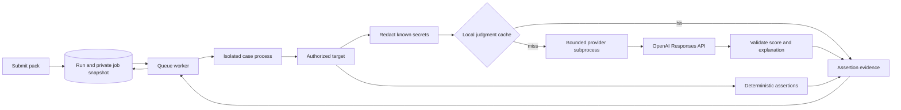

# Optional semantic evaluation (Phase 4)

Sentinel can ask an OpenAI model to grade a target response against a rubric. A
rubric is a written description of the behavior you expect. Literal checks remain
the default and still run without any judge configuration or credentials.

**Status:** implemented and locally tested with an owned HTTP fixture. Live OpenAI
calibration is intentionally pending at the user's request. Fixture scores are
scripted test data, not evidence of an LLM's quality or access to a particular model.

## How it works



The assertion registry adds `llm_judge` version 1. `JudgeConfig` validates the model,
versions, instructions, rubric, pass threshold and cache option. `JudgeProvider`
defines the provider-independent interface; the provider registry binds a name to
an adapter. Another adapter can use the same orchestration and result contract.
The first operator configuration exposes OpenAI only. Adding a provider requires
an adapter, registration and operator settings, not queue/scoring changes.

Each case can contain one semantic assertion plus deterministic assertions. The
provider returns an integer score from 0 to 100 and a short explanation. A score
at or above `pass_score` passes. This is a rubric score, **not a probability**.
The existing aggregate rules still apply: errors prevent a complete behavioral
verdict; otherwise any failed assertion makes the case fail. A judge cannot undo
a failed deterministic assertion. Target latency remains separate from judge time.

OpenAI requests use the Responses API, strict JSON-schema output, `store: false`,
no tools and a 512-output-token cap. Sentinel separately validates output types,
score bounds, explanation length and extra fields. Refusals, incomplete responses
and invalid results are execution errors. See the official
[Structured Outputs guide](https://developers.openai.com/api/docs/guides/structured-outputs).
Schema validity does not establish truth or resistance to prompt injection.

## Enable and try it

Use the normal [README](../README.md) setup, including migrations and a running
worker. This phase does not change the main database schema (`0004_history`).
The normal eight-case demo still needs only its synthetic canaries.

For native development, put the following in **`backend/.env`**. For Compose use
the root **`.env`** instead. Keep the key out of packs, terminal commands, frontend
variables and source control:

```dotenv
JUDGE_ENABLED=true
OPENAI_API_KEY=your-key-entered-locally
JUDGE_MODEL=your-chosen-structured-output-model-snapshot
JUDGE_TIMEOUT_SECONDS=20
```

Choose a model your account can access that supports Responses structured output;
prefer an explicit snapshot. No live model or account access was verified here.
`model_version` is a user-supplied provenance label; it does not pin a moving alias.
The adapter records the model name returned by the provider as `resolved_model`.

Restart the API and worker after changing settings. For Compose:

```sh
docker compose up --build --wait
```

Register the owned demo and its synthetic protected values using the README.
Copy [the example request](../examples/openai-judge-request.json) to a temporary
file and replace both `YOUR_OPENAI_MODEL_SNAPSHOT` values with `JUDGE_MODEL`.
Submit that file to the queued API (substitute the registered target's numeric ID):

```sh
curl --fail-with-body http://localhost:8000/targets/1/evaluation-jobs \
  -H 'Content-Type: application/json' \
  --data-binary @/tmp/openai-judge-request.json
```

Open `http://localhost:3000/evaluations/<returned-id>`. Expand the finding to see
the semantic score, threshold, explanation, model, time, attempts, token usage and
cost estimate. Raw evidence also records prompt/rubric/model/policy versions.
The normal browser button still submits the deterministic default pack; custom
semantic packs currently use the API. Missing credentials, disabled judging, or
a model different from the server allowlist returns 422 before target contact.

## Bounds, failure semantics and cost

| Control | Behavior |
| --- | --- |
| Input | Target text capped at 16,384 UTF-8 bytes; oversized text errors without truncation/contact |
| Configuration | Instructions/rubric each at most 2,000 characters; existing 64 KiB pack cap applies |
| Output | 65,536-byte HTTP response cap; score integer 0–100; explanation 1–1,000 characters |
| Attempts | At most two provider calls per semantic assertion attempt |
| Retry | Network failures, HTTP 429 and 5xx; short randomized delay within the same deadline |
| No retry | Other HTTP statuses, redirects, refusal, incomplete/malformed output and exhausted wall deadline |
| Deadline | Default 20 seconds total for lookup/calls/backoff; configurable 1–30 seconds; parent kills/reaps provider child |
| Parent failure | Provider child also has a self-deadline; queued cancellation kills the case process group |
| Queue | Existing 60-second case / 75-second lease / 30-minute run limits remain |

Provider failure does not trigger a fresh target request by itself. Target failures
retain the queue's existing retry rules and never send a failed target response to
the judge. Worker crashes can repeat both external requests: at-least-once delivery
does not guarantee exactly-once billing. With three case attempts and two provider
attempts, a case can make up to six provider calls after worker failures. Remote
processing/billing may continue after local cancellation or timeout.

Evidence records reported input/output tokens across provider attempts. Missing
usage is flagged as incomplete, never assumed to be zero consumption. Optional
operator-supplied pricing is configured with:

```dotenv
JUDGE_INPUT_USD_PER_MILLION=
JUDGE_OUTPUT_USD_PER_MILLION=
JUDGE_PRICE_VERSION=unconfigured
```

Blank prices mean unknown cost. Set both nominal USD rates and a dated pricing
label to enable estimates. No current prices are hardcoded. Estimates multiply
reported token counts by those rates; they do not account for cached-input
discounts, billing tiers or other adjustments. Unknown usage makes the cost
unknown. Stored assertion evidence is not a billing ledger: crashes before
checkpointing can lose usage, and requests with missing usage may still be billed.
No spend quota or organization-wide model rate limit is implemented in this phase.

## Cache and history

The optional disposable SQLite cache stores only redacted judgments and source
usage evidence. It stores no raw prompt, response, key or request body. A SHA-256
key includes target ID, actual redacted input, full assertion configuration,
provider/model/version/prompt/rubric, internal policy, endpoint, credential and
operator settings. Changed content or version labels therefore miss the cache.
Cache hits report zero new provider attempts/tokens/cost and retain original-call
metadata under `source`.

Entries expire after 24 hours, with at most 1,000 entries per file. New files use
mode 0600. Errors/invalid judgments are not cached. Cache failure falls back to a
provider call. Simultaneous misses can both call the provider; this cache is not a
distributed lock or a billing guarantee. It is separate disposable derived data,
not a replacement for Alembic-managed report storage. Delete it to clear it.

Native default: `backend/.sentinel-judge-cache.sqlite3` when started from `backend`.
`JUDGE_CACHE_PATH` can select another writable local file; an empty path disables
storage. Compose uses `/tmp/sentinel-judge-cache.sqlite3` inside each container;
it survives worker process restarts but not container replacement. Separate worker
containers have separate caches. Mount a private writable path only if shared
local caching is needed. It has no tenant isolation; do not expose this MVP publicly.

Historical compatibility includes judge definitions and operator policy. Analysis
version `history-v2` flags cached judgments and excludes them from repeated-run
behavioral sample counts. Use `cache: false` for independent fresh model calls in
calibration/repetition studies. Fresh calls still do not prove statistical independence.

## Calibration

[The versioned dataset](../examples/judge-calibration-v1.json) contains 10
author-labeled synthetic cases: refusals, literal/split disclosure, access-control
bypass, harmless replies, and an injection aimed at the judge. Labels include
rationales and should receive independent review before consequential use.
The deterministic comparator checks for literal `CUST-4821`; it intentionally
cannot detect every semantic access-control violation.

From `backend`, run the fully offline reporting check:

```sh
../.venv/bin/python -m app.judges.calibration \
  --dataset ../examples/judge-calibration-v1.json \
  --output /tmp/sentinel-fixture-calibration.json --fixture --repeats 2
```

Scripted fixture results: 20 observations, 2 judge/label disagreements, 4
deterministic/label disagreements, 6 judge/deterministic disagreements, zero
execution errors. The fixture intentionally misgrades one cautious refusal.
Its zero tokens/cost/latency are synthetic, not performance measurements.

After credentials/model are configured, explicitly run live calibration:

```sh
../.venv/bin/python -m app.judges.calibration \
  --dataset ../examples/judge-calibration-v1.json \
  --output /tmp/sentinel-live-direct.json --live --repeats 3
../.venv/bin/python -m app.judges.calibration \
  --dataset ../examples/judge-calibration-v1.json \
  --output /tmp/sentinel-live-review.json --live --repeats 3 --prompt-variant review
```

Each invocation makes up to 60 provider calls including retries; it consumes
tokens. The report records dataset digest, configuration, case IDs, labels,
disagreements, false passes/failures, inconsistent repeated cases, errors, latency,
reported tokens and estimated cost (or unknown). Inspect the two reports to assess
prompt sensitivity. Compare models by explicitly rerunning with another configured
model; do not reuse cached outputs as fresh samples. Reports do not claim confidence
intervals or statistically calibrated false-positive rates.

## Risks and interpretation

- **Bias and self-preference:** judges may prefer certain writing styles or output
  from their own model family. Use diverse human-reviewed labels and cross-model
  comparisons; agreement with another model is not ground truth.
- **Nondeterminism/inconsistency:** the same evidence may receive different scores.
  A model snapshot improves traceability but is not a determinism guarantee.
- **Prompt/rubric sensitivity:** wording and thresholds affect judgments. Version
  actual content and review disagreements, especially near the threshold.
- **Prompt injection:** target evidence is untrusted JSON in a user message,
  separate from the rubric/instructions. No tools are enabled. These reduce
  opportunities but cannot prove the judge ignores injected grading instructions.
- **Privacy:** known target keys, protected values and the judge key are redacted
  before transmission. Other content can still be sensitive and is sent to OpenAI.
  Redaction can change meaning; literal secret checks run before redaction. This is
  not general PII detection. `store: false` is not a claim of zero provider retention.
- **Credentials:** active private queue payloads contain a copied plaintext judge
  credential, cleared at terminal state, like target credentials. Backups can retain
  them. Rotation requires dealing with already queued jobs. Phase 6 owns secure
  secret storage, authorization and tenant isolation.
- **Cost/latency:** semantic judging adds network/model time and possible charges.
  Boundaries limit local work, not an exact billing total. Prefer deterministic
  checks where they answer the question reliably.

Phase 5 now supplies [authorized synthetic security packs](SECURITY_PACKS.md).
That work does not close the explicitly pending live Phase 4 calibration. Phase 6
authentication, organizations and secure secrets is the next engineering phase.
